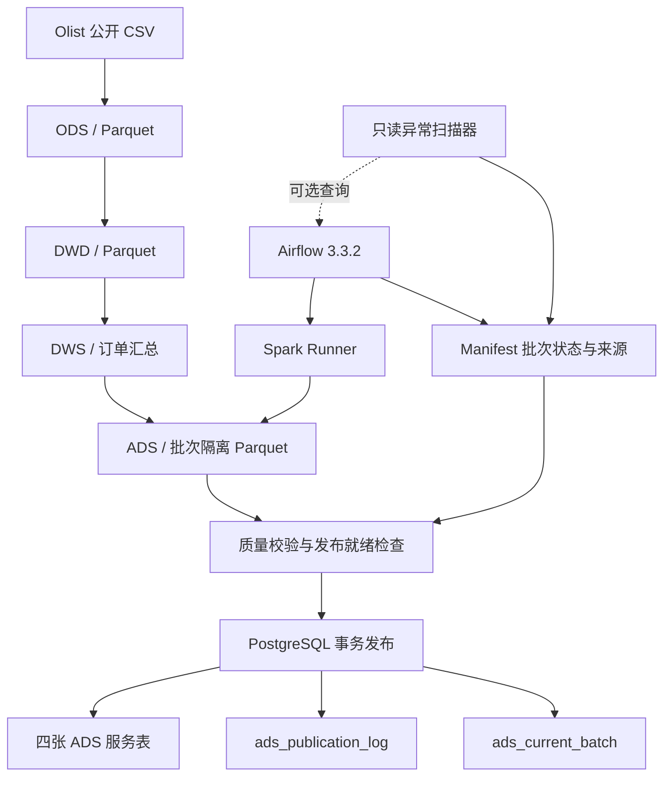

# Olist 电商数据仓库｜Spark + Airflow + PostgreSQL

> 基于公开 Olist Brazilian E-Commerce 数据集的本地数据开发工程实践。项目重点是数仓分层、批次隔离、数据质量、原子发布、调度编排和故障恢复；**不是** PB 级生产数仓或性能压测项目。

## 1. 项目概述

以 Olist 公开电商订单数据为输入，使用 Apache Spark 构建 ODS → DWD → DWS → ADS 离线数仓。ADS 数据先写入独立批次目录，经数据质量检查和发布就绪校验后，由 Python/psycopg 在一个 PostgreSQL 事务中发布至四张服务表。Apache Airflow 编排完整任务链；Manifest 保存批次状态及调度来源；健康扫描器识别超时批次、路径问题并可关联 Airflow DAG Run 状态。

**项目定位：** 单机 Docker + Spark 本地模式的可复现实战工程，侧重数据正确性和发布可靠性，不宣称分布式生产吞吐量。

## 2. 技术栈

| 环节 | 技术 | 职责 |
|---|---|---|
| 批量处理 | Apache Spark 4.2.0（Python） | 读取源数据、数据清洗与数仓指标计算 |
| 数据存储 | CSV、Parquet | 原始输入与数仓中间结果 |
| 工作流 | Apache Airflow 3.3.2 | 九任务有序编排、运行日志和任务状态 |
| 服务层 | PostgreSQL 17 | ADS 查询表、当前批次指针和发布历史 |
| 发布控制 | Python、psycopg、PyArrow | 批次校验、事务发布和状态恢复 |
| 部署 | Docker Compose | Airflow、Spark Runner、PostgreSQL 服务与共享网络 |
| 测试 | `unittest` / `unittest.mock` | 发布状态与幂等恢复分支的自动化回归 |

## 3. 架构



详细流程与状态保护见 [docs/ARCHITECTURE.md](docs/ARCHITECTURE.md)。

## 4. 数据集与数仓产出

**输入数据：** Olist Brazilian E-Commerce 公共数据集，项目使用的原始 CSV 包括订单、订单商品、支付、客户、商品、卖家等。已核验部分源表行数：

| 源表 | 行数 |
|---|---:|
| `orders` | 99,441 |
| `order_items` | 112,650 |
| `order_payments` | 103,886 |
| `customers` | 99,441 |
| `products` | 32,951 |
| `sellers` | 3,095 |

项目已构建 DWD 明细层、DWS 订单汇总层和四张 ADS 数据集。已核验的服务层行数：

| ADS 数据集 / PostgreSQL 服务表 | 行数 |
|---|---:|
| `daily_sales` / `ads_daily_sales` | 634 |
| `customer_purchase_profile` / `ads_customer_purchase_profile` | 93,358 |
| `customer_repurchase` / `ads_customer_repurchase` | 1 |
| `category_sales` / `ads_category_sales` | 74 |

DWS `order_summary` 包含 **99,441** 行。已核验的交付商品金额指标约 **13,221,498.11 BRL**；该数值按本项目的业务口径计算，不应与平台 GMV 等概念直接等同。

> 数据说明：原始数据规模为公开教学/实验规模。README 中不使用未经验证的性能提升倍率或 PB 级处理量。

## 5. 端到端调度任务

Airflow DAG：`olist_m6_ads_full`。目前验证通过的九任务顺序：

```text
prepare_batch
  → build_daily_sales
  → build_customer_ads
  → build_category_sales
  → record_all_ads
  → validate_batch
  → check_publish_ready
  → publish_batch
  → verify_publication
```

- `prepare_batch`：基于 DAG Run ID 构造唯一批次 ID，创建 Manifest，记录 Airflow 来源，并切换到 `RUNNING`。
- 三个 `build_*` 任务：通过 Spark Runner 生成按批次隔离的四份 ADS Parquet 结果。
- `record_all_ads`：将产物路径和元数据登记到 Manifest。
- `validate_batch` / `check_publish_ready`：检查行数、质量规则及发布条件。
- `publish_batch`：通过 PostgreSQL 事务原子替换四张 ADS 服务表，并同步记录发布历史和当前批次。
- `verify_publication`：核验 Manifest 和数据库当前批次指针。

### 批次状态及来源

```text
CREATED → RUNNING → VALIDATED → PUBLISHED
                  ↘ FAILED（失败情形，具体合法迁移以代码为准）
```

示例 Manifest 来源字段：

```json
{
  "source": {
    "system": "airflow",
    "dag_id": "olist_m6_ads_full",
    "run_id": "<actual-airflow-run-id>"
  }
}
```

老批次允许缺少 `source`，不自动伪造运行来源。

## 6. 可靠性设计

### 6.1 批次隔离与校验

每个新批次的数据写入 `data/batches/<batch_id>/ads/<table>/`，避免并发或重试任务直接覆盖共享 ADS 产物。发布前必须通过质量校验和就绪检查。

### 6.2 PostgreSQL 原子发布

`src/pipeline/publish_batch.py` 使用事务级建议锁 `pg_advisory_xact_lock`，在同一数据库事务中完成四表替换、指标检查、`ads_publication_log` 插入和 `ads_current_batch` 更新。受控发布程序使用相同锁键时，发布事务被串行化。

### 6.3 幂等与异常恢复

- 已发布且仍为当前批次：识别为恢复/重复请求，不再执行 ADS `TRUNCATE`。
- 已发布但不再是当前批次：拒绝重新发布历史快照。
- 数据库已提交但 Manifest 仍为 `VALIDATED`：依据发布日志和当前指针修复 Manifest 为 `PUBLISHED`，不重复插入发布日志。
- **边界：** 锁并不自动确保“尚未发布的新旧批次”严格按业务时间先后发布；该顺序策略尚未在本项目中独立验证。

### 6.4 只读批次健康扫描

`src/pipeline/detect_stale_batches.py` 检查长时间停留在 `CREATED`/`RUNNING` 的批次、Manifest 路径和产物目录问题。可通过 `--check-airflow` 查询 DAG Run 状态。超时只表示待调查，**不能直接判定失败或自动修改状态**。

```powershell
.\.venv-serving\Scripts\python.exe .\src\pipeline\detect_stale_batches.py --threshold-minutes 60
.\.venv-serving\Scripts\python.exe .\src\pipeline\detect_stale_batches.py --threshold-minutes 60 --check-airflow
```

`--check-airflow` 当前依赖 Windows 主机通过 Docker CLI 访问 `olist-airflow`；此实现不等于容器化/远程部署时可直接工作。

## 7. 主要目录（已确认部分）

```text
SparkEcommerce/
├── airflow/
│   ├── compose.yaml
│   └── dags/olist_m6_ads_full.py
├── compose.yaml
├── data/
│   ├── raw/olist/            # 公开 CSV
│   ├── dwd/
│   ├── dws/
│   └── batches/<batch_id>/
├── jobs/spark_job_runner.py
├── src/
│   ├── transformations/      # ADS 相关 Spark 计算
│   ├── pipeline/
│   │   ├── batch_manager.py
│   │   ├── validate_batch.py
│   │   ├── check_publish_ready.py
│   │   ├── publish_batch.py
│   │   └── detect_stale_batches.py
│   └── serving/
├── tests/pipeline/test_publish_recovery.py
└── docs/
```

目录树仅列出已核实的部分，不代表完整仓库清单。密钥、Airflow运行状态和数据卷不应提交到公开仓库。

## 8. 本地检查与测试

从仓库根目录 `D:\SparkEcommerce` 执行以下**已经核验过的检查命令**（示例面向 Windows PowerShell）：

```powershell
# 配置静态检查
docker compose config --quiet

# Airflow DAG导入检查
docker exec olist-airflow airflow dags list-import-errors --local

# 任务列表
docker exec olist-airflow airflow tasks list olist_m6_ads_full

# 单元测试：不连接真实PostgreSQL
.\.venv-serving\Scripts\python.exe -m unittest discover -s tests/pipeline -p "test_publish_recovery.py" -v

# Git格式检查
git diff --check
```

数据库当前发布状态的只读核验：

```powershell
docker exec olist-postgres psql -U olist -d olist_warehouse -c "SELECT * FROM ads_current_batch;"
docker exec olist-postgres psql -U olist -d olist_warehouse -c "SELECT batch_id, status FROM ads_publication_log ORDER BY batch_id;"
```

**部署前置条件：** 根目录 Compose 引用 `olist-airflow_default` 外部网络。首次搭建新环境时需先由 Airflow Compose 创建该网络；PostgreSQL 再通过根目录 Compose 加入。数据库密码通过本地环境变量/挂载的密钥文件提供，切勿提交密码文件。完整从零部署与数据构建命令需要对照实际仓库脚本进一步核验，此处不提供未经验证的“一键启动”指令。

## 9. 已验证结果与测试边界

截至 2026-11-03 的本地验证记录：

- 完整九任务 DAG 曾 **9/9 成功**；当时服务批次为 `m6_full_cb29be2ec233b189`。
- 发布日志共有 **4条**，当前批次 Manifest 状态为 `PUBLISHED`；服务表行数与 Manifest 一致。
- **4/4 Mock 单元测试通过**：拒绝 `RUNNING` 发布、当前批次幂等重试、历史批次拒绝重发布、数据库已提交但 Manifest 未更新时恢复。
- Docker Compose 跨项目共享网络配置已应用，Airflow 至 PostgreSQL 的 TCP 连通性已验证，原数据卷保持不变。
- Airflow `tasks test` 已真实执行 `prepare_batch`，证明 `dag_id` / 实际临时 `run_id` 写入 Manifest；该测试批次随后被**人为标记** `FAILED` 以结束测试，不能解释为Airflow任务失败。
- 本轮没有重新执行真实数据库故障注入或并发压力测试；也不宣称已完成云端/集群部署。

## M9—M11：维度建模、销售主题与独立调度扩展

### M9：事实维度建模及财务对账

在原有离线数仓基础上，新增订单、订单商品、支付三个事实表，以及客户、商品、卖家三个维度表。

主要模型：

| 模型 | 数据粒度 | 已验证行数 |
|---|---|---:|
| `fact_order` | 每笔订单一行 | 99,441 |
| `fact_order_item` | 每笔订单的每个商品明细一行 | 112,650 |
| `fact_payment` | 每笔订单的每条支付记录一行 | 103,886 |
| `dim_customer` | 每个customer_id一行 | 99,441 |
| `dim_product` | 每个product_id一行 | 32,951 |
| `dim_seller` | 每个seller_id一行 | 3,095 |

针对订单商品与支付记录之间可能存在的一对多、多对多关联问题，先分别按`order_id`聚合，再与订单主表关联，避免直接Join导致金额重复累计。

订单财务汇总表`order_financial_summary`保留99,441笔订单，并对商品金额、运费和支付金额分别进行守恒验证。

已验证总金额：

- 商品金额：13,591,643.70 BRL
- 运费金额：2,251,909.54 BRL
- 支付金额：16,008,872.12 BRL

上述金额口径不同，不将支付金额与商品加运费的差额直接解释为利润或退款。

M9数据质量程序共32项P0检查通过，同时保留缺失商品、缺失支付、商品维度属性缺失等异常记录与分析结果。

相关文档：

- `docs/M9_DIMENSIONAL_MODEL.md`
- `docs/M9_QUALITY_REPORT.md`

### M10：销售主题数据仓库扩展

基于M9订单财务汇总，新增两层销售主题模型：

`order_financial_summary → sales_daily → sales_monthly`

**日销售DWS**

输出路径：`data/m10/dws/sales_daily`

- 粒度：每个购买日期一行。
- 实际记录数：634。
- 统计订单量、有商品订单量、有支付订单量、最终已送达订单量、取消订单量、商品金额、运费、支付金额和缺失记录数。
- 99,441笔订单全部保留，日期空值和重复均为0。
- 商品金额、运费、支付金额分别通过跨层对账。

**月度销售ADS**

输出路径：`data/m10/ads/sales_monthly`

- 粒度：每个有订单的购买月份一行。
- 实际记录数：25。
- 从日销售DWS聚合得到月度订单、金额和业务状态指标。
- 平均订单商品金额、最终送达订单占比均按汇总后的分子与分母计算，不直接平均每日比率。
- 11项日月至月度累计指标对账通过。

**历史指标回归测试**

使用`FULL OUTER JOIN`对比原有`daily_sales`ADS和新建`sales_daily`DWS。

验证结果：

- 双方日期行数：634 / 634
- 缺失日期：0
- 订单数量差异：0
- 已送达订单数量差异：0
- 已送达商品金额差异：0

业务口径说明：按照订单购买日期分组，并依据数据快照中的最终订单状态判断是否已送达；不代表实际送达当天的业务量。

### M11：Airflow独立批次调度

新增独立DAG：`olist_m10_sales`。

任务顺序：

```text
prepare_batch
    → build_daily
    → build_monthly
    → validate_sales
    → verify_outputs
```

主要工程设计：

- Airflow依据DAG Run ID生成独立批次标识。
- Spark Runner使用作业白名单限制允许执行的程序。
- 通过`--batch-id`传递批次标识，确保上下游使用同一批次。
- 批次结果输出到`data/batches/<batch_id>/m10/`。
- 采用`errorifexists`禁止意外覆盖已有结果。
- 最终质量门禁校验日级、月级粒度、行数及跨层汇总一致性。

**实际运行验收：2026-11-04**

- DAG状态：SUCCESS
- 成功任务：5/5
- 任务失败数：0
- Airflow显示的执行时间：约1分01秒

该DAG采用`schedule=None`，目前由用户手动触发，但各任务由Airflow自动按依赖执行；不宣称已部署定时生产调度。

### 工程边界

项目同时保留两条已验证的调度链路：

1. `olist_m6_ads_full`：原有四张ADS的批次校验、PostgreSQL事务发布与恢复。
2. `olist_m10_sales`：新增日销售DWS、月度ADS的独立批次构建、回归验证与最终验收。

**M10月度ADS目前尚未集成到PostgreSQL事务发布流程。** M10批次隔离及拒绝覆盖机制也不等同于完整的自动断点恢复。

项目在本地Docker与Spark `local[2]`环境中完成验证，不声称已经具备生产级分布式部署能力。

## 10. 后续完善方向

1. 将已验证的执行日志、SQL指标口径和数据质量规则整理为独立文档。
2. 增加隔离测试数据库中的事务故障注入与并发测试，避免在服务库上反复发布。
3. 对尚未发布的旧批次增加明确的业务版本顺序约束（如有需要）。
4. 补齐从零部署、首次装载数据、许可证和数据下载来源说明。
5. 整理面试问答：数仓分层、数据倾斜、Spark执行计划、PostgreSQL事务、Airflow调度与异常恢复。
