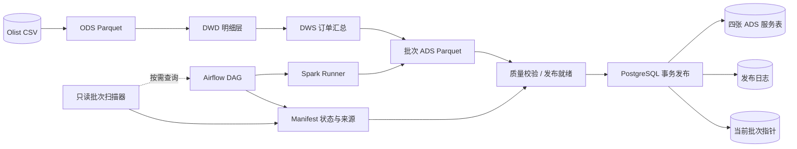
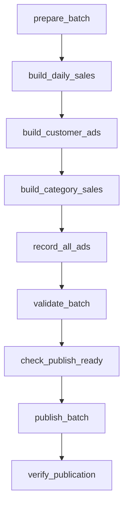
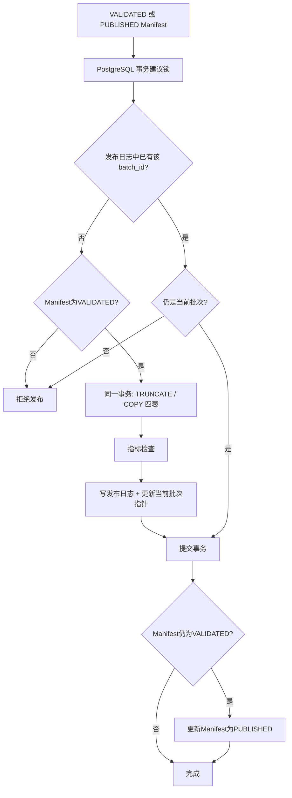
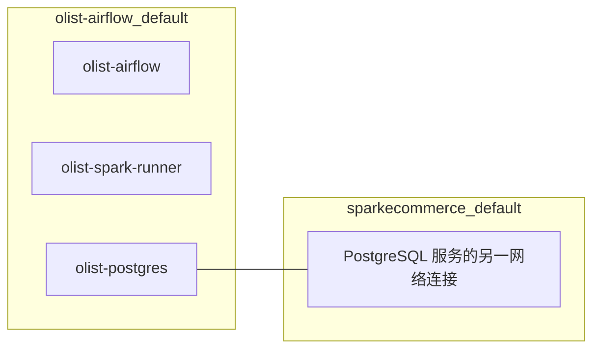

# Olist 数仓架构与发布链路

## A. 逻辑架构

## B. 九任务编排

上述为项目中已经验证的任务依赖顺序，**不是**并发执行图。

## C. 发布事务与恢复路径

**注意：** 本图是对现有 `publish_batch.py` 逻辑的概括。事务锁只协调使用同一锁键的发布路径；数据库提交后到Manifest更新前仍存在短暂的跨系统状态不一致窗口，依靠后续重试恢复。

## D. Docker网络

根目录 `compose.yaml` 的 PostgreSQL 服务使用 `default` + `airflow_shared` 网络；顶层 `airflow_shared` 以 `external: true` 指向 `olist-airflow_default`。网络由 Airflow Compose 创建，因此部署顺序需要确保网络先存在。PostgreSQL的数据由独立命名卷 `sparkecommerce_postgres_data` 保存。

## E. 验收证据索引

| 证据 | 已观察结果 |
|---|---|
| `airflow tasks list olist_m6_ads_full` | 九个任务均存在 |
| 完整 M6 DAG 运行 | 九任务完成，历史执行记录 `success` |
| `ads_current_batch` | `m6_full_cb29be2ec233b189`（2026-11-03验证） |
| `ads_publication_log` | 四条记录（2026-11-03验证） |
| `unittest discover` | 四项 Mock 测试通过 |
| `prepare_batch`任务测试 | 新建含实际 Airflow 临时 Run ID 的 Manifest |
| Docker网络连通 | `POSTGRES NETWORK: PASS` |

本文件不包含源数据文件或用户本地密钥。
